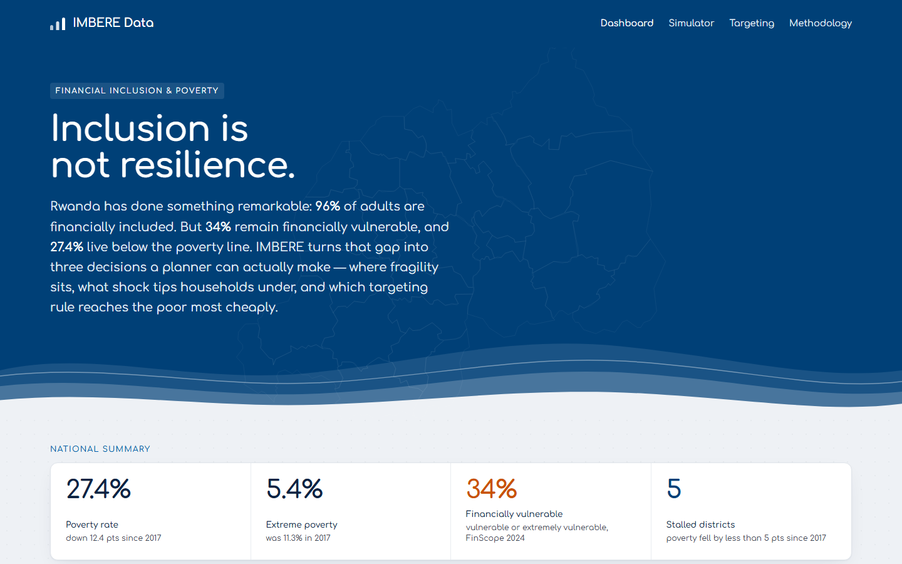
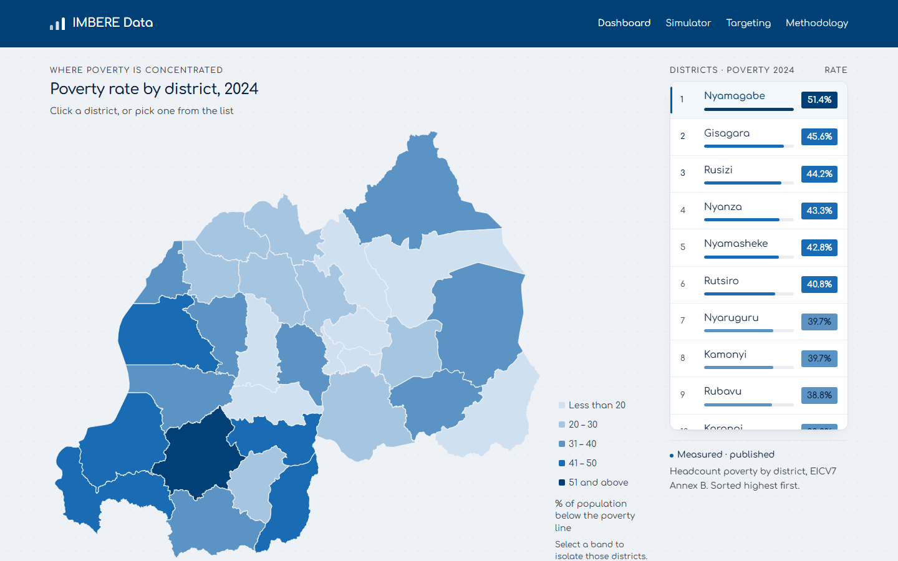
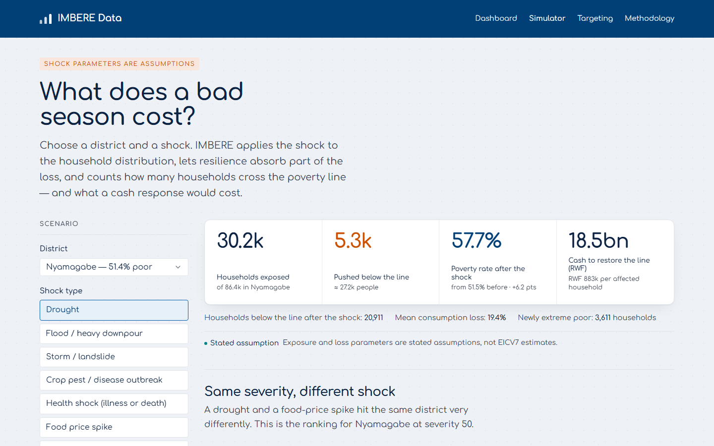
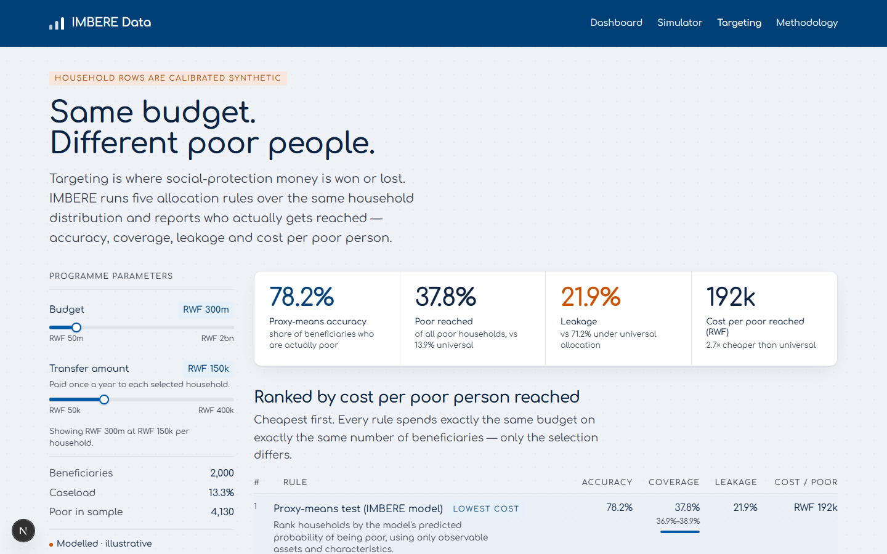
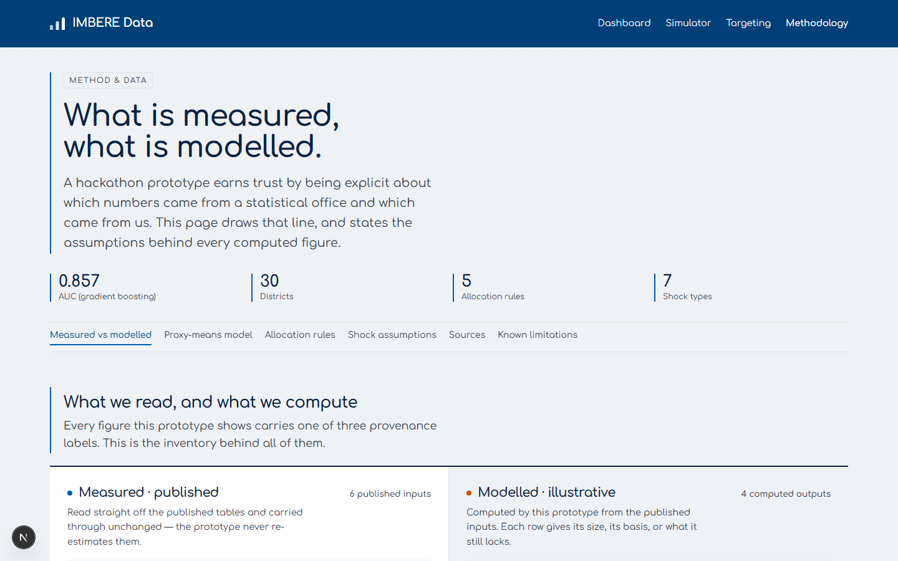

# IMBERE DATA

**Financial resilience and social-protection targeting intelligence for Rwanda.**

Built for the NISR 2026 Big Data Hackathon — Track 2: Financial Inclusion & Poverty Reduction.
Aligned with **NST2** (Social Transformation) and **Vision 2050**.

> **Watch the pitch (2:46) →** [`media/imbere-pitch.mp4`](media/imbere-pitch.mp4) · captions in
> [`media/imbere-pitch.srt`](media/imbere-pitch.srt). The video is a required part of the
> submission, not an extra: it is the only place the argument runs end to end.

---

## The problem

Rwanda has achieved something genuinely rare: **96% of adults are financially included**. Mobile
money is near-universal, and the urban–rural and gender gaps have narrowed to about one point.

But access is not the same as resilience.

- **34%** of adults are financially *vulnerable* or *extremely vulnerable* (FinScope 2024)
- **27.4%** of the population lives below the poverty line, **5.4%** in extreme poverty (EICV7)
- **37.1%** of households reported at least one severe shock in the past year (EICV7)
- Only **30%** of those exposed to a climate shock took any financial mitigation measure (FinScope)
- Poverty reduction has **stalled in 5 of 30 districts**, where it fell by less than 5 points since 2017

A mobile wallet does not stop a drought. The policy question is not *"who has an account?"* but
*"who is one shock away from the poverty line, and which intervention reaches them most cheaply?"*

IMBERE answers that question in three modules.

---

## What it does



### 01 · Where fragility sits
A 30-district map of headcount poverty (2024 and the change since 2017), joined to district
populations and household counts. District detail shows mobile-money coverage, savings coverage,
reported shock incidence and a resilience index.



The map uses the same legend bins as the EICV7 Poverty Profile so the two can be read side by side.

### 02 · What a shock costs
Pick a district, a shock type and a severity. IMBERE applies the shock to the household
distribution, lets household resilience absorb part of the loss, and reports:

- households exposed
- households pushed below the poverty line (and into extreme poverty)
- the district poverty rate before and after
- the cash required to bring every affected household back to the line



### 03 · Which targeting rule works
Run five allocation rules against the same budget and the same household distribution:

| Rule | Idea |
|---|---|
| Universal | Random allocation — the benchmark |
| Geographic | Rank districts by poverty rate |
| Community-based | Rank by asset poverty (Ubudehe-style) |
| Financial-exclusion first | Prioritise the unbanked and unsaved |
| **Proxy-means test** | Rank by the model's predicted poverty probability |

Reported for each: targeting accuracy, coverage of the poor, leakage, exclusion error and cost per
poor person reached.



---

## Headline result

At a **RWF 300m** budget with **RWF 150,000** per beneficiary (2,000 households, 13.3% caseload):

| Rule | Accuracy | Poor reached | Leakage | Cost per poor reached |
|---|---:|---:|---:|---:|
| Universal | 28.8% | 13.9% | 71.2% | RWF 520,833 |
| Geographic | 45.3% | 21.9% | 54.7% | RWF 331,126 |
| Community-based | 57.6% | 27.9% | 42.4% | RWF 260,417 |
| Financial-exclusion first | 61.0% | 29.5% | 39.0% | RWF 246,103 |
| **Proxy-means test** | **78.2%** | **37.8%** | **21.9%** | **RWF 191,939** |

**On the calibrated layer, the proxy-means rule reaches 2.7× more poor households than universal
selection for the same money, and cuts leakage from 71.2% to 21.9%.** Read the ratio as a statement
about the method rather than about Rwanda: the joint distribution underneath it was calibrated to
published EICV7 marginals, so 2.7× is what a proxy-means test achieves *when* asset–consumption
separation looks like the published gradients. Geographic targeting captures most of the gain at a
fraction of the data cost — which matters where a full household survey is unavailable.

> These figures come from calibrated synthetic household rows. The engines do not change when the
> real EICV7 microdata is loaded — only the rows they read. See [Method](#method).

---

## Recommendations

Five programme implications, read from the calibrated layer above. Each is a statement about the
*method* — what a rule of this kind achieves **when** asset–consumption separation looks like the
published EICV7 gradients — and each needs re-checking against the real microdata before it
informs a budget.

1. **Prefer a proxy-means test to a universal transfer wherever a recent survey exists.** For the
   same RWF 300m it reaches 2.7× more poor households and cuts leakage from 71.2% to 21.9%. The
   gain is large enough to pay for the household survey that supplies its features.

2. **Keep geographic targeting as the operational fallback, not the ambition.** Ranking districts
   by poverty rate reaches 21.9% of the poor — most of what community-based listing achieves
   (27.9%) at a fraction of the data cost. It is the right rule between survey rounds, and the
   only one that works where no survey exists at all.

3. **Index disaster response to shock exposure, not only to poverty status.** 37.1% of households
   reported a severe shock in the past year, and only 30% of those exposed took any financial
   mitigation measure. A roster frozen at the last poverty line misses the households that cross
   it *after* the shock — precisely the population a drought transfer is meant to reach.

4. **Report intervals alongside point estimates.** Every headline figure now carries a bootstrap
   95% interval over the household sample. Where an interval straddles the gap between two rules,
   the data cannot choose between them and the write-up should say so.

5. **Treat access as solved and resilience as not.** Mobile money reaches 86.9% of adults while
   only 68.2% save. The binding constraint is no longer an account — it is a buffer. Cash paired
   with a savings or insurance nudge does more per franc than either alone.

> **These are prototype implications, not findings about Rwanda.** Household rows are calibrated
> synthetic, and the rules measure selection performance, not programme impact. Load the EICV7
> microdata, re-run `evaluate_targeting`, and treat any figure that moves by more than its own
> interval as provisional.

---

## Videos

Two videos are part of the submission and both are required: the pitch carries the argument, and
the screen recording shows the prototype running.

| Video | What it covers | Length | Link |
|---|---|---|---|
| **Pitch** — required | Problem, the three modules, the headline result, measured vs modelled, and where it sits against NST2 and Vision 2050 | 2:46 | **[media/imbere-pitch.mp4](media/imbere-pitch.mp4)** · captions [imbere-pitch.srt](media/imbere-pitch.srt) |
| Screen-recorded demo — required | The prototype captured in Chrome: overview, district detail, shock simulator, targeting lab, methodology | 4:41 | **[Watch on Google Drive](https://drive.google.com/file/d/1Ccac1gl9cttLDfYVWb3dwWqZ-audmsKX/view?usp=sharing)** |

Both videos show results computed on the calibrated synthetic household rows — the same numbers as
the table above, which are prototype figures rather than Rwanda's. The pitch says so on screen and
in the narration; the demo's figures carry the same `Modelled · illustrative` marking as the app.

---

## Architecture

```
┌─────────────────────────────┐        ┌──────────────────────────────┐
│  Next.js 16 + Tailwind      │  HTTP  │  FastAPI                     │
│  · Overview / map           │ ─────► │  · /api/districts            │
│  · Shock simulator          │        │  · /api/simulate             │
│  · Targeting lab            │        │  · /api/targeting            │
│  · Method & data            │        │  · /api/model  /api/meta     │
└─────────────────────────────┘        └──────────────┬───────────────┘
                                                      │
                                       ┌──────────────▼───────────────┐
                                       │  data/processed              │
                                       │  districts.json  (REAL)      │
                                       │  meta.json       (REAL)      │
                                       │  households.csv  (CALIBRATED)│
                                       └──────────────────────────────┘
```

---

## Quickstart

**One command (Windows).** `run.cmd` (or `.\run.ps1`) installs any missing dependencies,
starts the API and the web app together, streams both logs into one window, opens the browser
and stops both services on Ctrl+C.

```powershell
.\run.ps1              # or: .\run.ps1 -ApiPort 8001 -NoBrowser
```

**Or start the two services by hand.**

**Backend** (Python 3.11+):

```bash
cd api
pip install -r requirements.txt
python -m uvicorn app.main:app --reload --port 8000
```

**Frontend** (Node 20.9+):

```bash
cd web
npm install
npm run dev
```

Open http://localhost:3000. The frontend reads `NEXT_PUBLIC_API_BASE` (default
`http://127.0.0.1:8000`).

**The data layer is prebuilt.** `data/processed/` is committed, so a clone runs the API with no
rebuild step.

**Verify a change.** The API carries a pytest suite covering the targeting engine, the shock
simulator, the model card, the household column contract and the HTTP layer. It pins the headline
figures quoted below, so a seed or calibration change fails loudly instead of drifting.

```bash
cd api
pip install -r requirements-dev.txt
python -m pytest tests -q       # engines, contract, cold start, HTTP
```

---

## Deployment

The demo runs as two services:

| | Platform | URL |
|---|---|---|
| Interface | Vercel | https://imberedata.vercel.app |
| Analytical API | Render (free tier, `render.yaml` blueprint) | https://imbere-data.onrender.com |

The frontend reads `NEXT_PUBLIC_API_BASE` at **build time**. Set it in Vercel to
`https://imbere-data.onrender.com` — no trailing slash — and redeploy after any change;
saving the variable alone does nothing.

Render's free tier sleeps after ~15 minutes without traffic. The first request after idle
wakes the service (30–60 s); subsequent requests are immediate.

---

## Data

| Dataset | Source | Use | Status |
|---|---|---|---|
| EICV7 Poverty Profile 2023/24 (Annex B, Tables 5.1, 6.3–6.11) | [NISR](https://statistics.gov.rw/data-sources/surveys/EICV/integrated-household-living-conditions-survey-7-eicv-7/eicv7-poverty-profile-report-202324) | District poverty, shock incidence, coping, asset gradients | **Real** |
| EICV7 Tables (Excel) | [NISR](https://statistics.gov.rw/sites/default/files/documents/2025-05/EICV7_Tables_Rwanda_Poverty_Profile.xlsx) | Transcribed tables | **Real** |
| FinScope 2024 | [NISR catalog 120](https://microdata.statistics.gov.rw/index.php/catalog/120) | Inclusion, financial health, climate exposure | **Real** |
| Census 2022 | [NISR](https://www.statistics.gov.rw) | District populations, household counts | **Real** |
| District boundaries | [geoBoundaries](https://www.geoboundaries.org) / NISR Open Data | Map geometry | **Real**, CC BY 4.0 |
| Household microdata | EICV7 catalog 119 / 121 (access pending) | Targeting and risk model | **Calibrated synthetic** |

Poverty lines: **RWF 560,127** per adult equivalent per year (total), **RWF 356,432** (extreme),
January 2024 prices.

Household microdata comes from the [NISR microdata portal](https://microdata.statistics.gov.rw/index.php/catalog):
register, open the EICV7 cross-sectional ([catalog 119](https://microdata.statistics.gov.rw/index.php/catalog/119))
or VUP ([catalog 121](https://microdata.statistics.gov.rw/index.php/catalog/121)) study, click
**Get Microdata** and submit the request form. The sign-up confirmation email can be ignored — log in
with the credentials you set — and public-use studies are normally released as soon as the form is
submitted.

### Method

Real inputs and modelled outputs are kept strictly separate in code and in the UI.

- **District poverty, populations, national indicators, shock prevalence and coping responses**
  are transcribed from published NISR/FinScope sources. Never modelled.
- **Household rows** are synthetic. Marginals are calibrated to published EICV7 figures:
  poverty 27.4%, extreme poverty 5.7%, shock incidence 37.1%, mobile money 86.9%,
  savings 68.2%, health insurance 85.6%, financial-health bands 9.9 / 56.4 / 30.7 / 3.0.
  The joint distribution is not observed data.
- **Shock exposure and loss parameters** are stated assumptions, surfaced in the UI and in
  `api/app/analytics.py`. They are not estimated from EICV7.



### Model

Proxy-means poverty risk model — `HistGradientBoostingClassifier`, consumption excluded from the
feature set by design.

- Hold-out AUC: **0.857** (logistic baseline 0.861)
- Features: district, province, head's education, income source, urban, household size,
  11 asset/housing indicators, district poverty rate
- Top signals: head's education, district poverty rate, TV ownership, income source, modern floor

AUC is measured on synthetic rows and describes the prototype, not Rwanda. Re-run against the
EICV7 file for publishable accuracy.

---

## Development notes

Non-obvious constraints that are easy to break when changing this repo:

- **`data/processed/` is generated but committed on purpose.** Don't gitignore it; the API loads
  it at startup and needs no build step.
- **Each targeting rule draws from its own RNG stream.** `_rule_rng` derives a generator from the
  seed and the rule's fixed position in `analytics.RULES`, so reordering or subsetting the rule
  list no longer moves the figures quoted above — and one score vector per rule is reused by the
  headline, the coverage curve and the bootstrap, so all three describe the same allocation.
- **Documented figures are duplicated.** The headline table appears in this README and in the
  companion methodology and submission write-ups; regenerating the data layer with a different
  seed or calibration means updating all of them plus `EXPECTED` in
  `api/tests/test_analytics.py`.
- **GeoJSON winding is load-bearing.** Boundary files re-downloaded from geoBoundaries must be
  rewound to the right-hand-rule convention, or d3-geo renders each district as "the whole
  sphere minus this polygon". Symptom: `d3.geoArea` ≈ 4π instead of < 2π.
- **Real vs modelled is a hard line.** `districts.json` and `meta.json` hold published NISR
  figures; `households.csv` is calibrated synthetic. The UI tags them *Measured* / *Modelled* —
  keep that distinction in code, API responses and every write-up.
- **Tailwind packages must stay version-locked together** (`tailwindcss`,
  `@tailwindcss/postcss`, `@tailwindcss/oxide`). A mismatch fails with the unrelated-looking
  `Missing field 'negated' on ScannerOptions.sources`.
- **`npm run dev` and `npm run build` call `node node_modules/next/dist/bin/next` on purpose**
  (built on a Windows host that cannot create `.bin` links); they work on every platform — don't
  rewrite them to bare `next`.
- **`NEXT_PUBLIC_API_BASE` is read at build time** — changing it requires a redeploy, and the
  value must not end with `/`.
- **Restart uvicorn after rebuilding data.** The datastore fits the poverty-risk model lazily on
  first request and caches it in module state.

---

## Repository layout

```
imbere-data/
├── api/
│   ├── app/
│   │   ├── datastore.py      # loaders, calibration, risk model
│   │   ├── analytics.py      # targeting rules, shock simulator
│   │   └── main.py           # FastAPI routes
│   ├── tests/                # pytest: engines, model card, HTTP contract
│   ├── requirements.txt
│   └── requirements-dev.txt
├── web/
│   ├── app/                  # Overview, simulator, targeting, method
│   ├── components/           # map, charts, UI primitives
│   ├── lib/                  # API client and formatting
│   └── public/rwanda-districts.geojson
├── data/
│   ├── raw/                  # transcribed NISR tables (source PDF/XLSX stay local)
│   ├── reference/            # national indicators, shock tables
│   └── processed/            # built JSON + calibrated households
├── run.ps1 / run.cmd         # one-command local startup (API + UI)
└── render.yaml               # Render Blueprint for the API
```

---

## Limitations

- Household rows are synthetic; rankings and accuracy are illustrative until EICV7 is loaded.
- FinScope 2024 publishes national, not district, estimates. District financial access comes from
  the EICV7 mobile-money and savings modules instead.
- EICV7 covers roughly 500 households per district, so district confidence intervals are wide.
- No causal claim: targeting results are selection performance, not programme impact.
- Cash-need figures are a costing exercise at the poverty line, not a budget or an evaluation.

## Licence and attribution

NISR data is published under CC BY 4.0. Boundaries from geoBoundaries / NISR Open Data, CC BY 4.0.
Per the competition rules, intellectual property in the submission is assigned to NISR.
